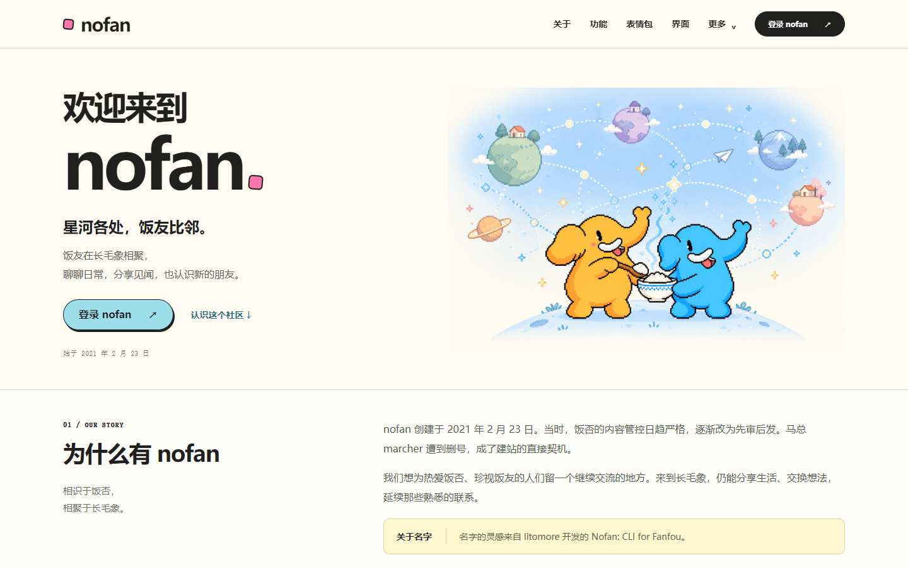

# nofan 首页

**星河各处，饭友比邻。**

nofan 的社区介绍页与 404 页面源码，包含本站功能、表情包、界面主题、机器人，以及博客、捐助、Beta 和开发路线图入口。

这是独立静态项目，使用原生 HTML、CSS 和 JavaScript，无需构建或安装运行依赖。当前仓库用于维护页面源码，不会自动替换线上网站。



## 本地查看

直接打开 `index.html`，或使用 Node.js 22 及以上版本启动本地服务：

```sh
git clone https://github.com/nofan-xyz/nofan-homepage.git
cd nofan-homepage
npm start
```

访问 [http://127.0.0.1:4173](http://127.0.0.1:4173)，404 预览位于 [http://127.0.0.1:4173/404.html](http://127.0.0.1:4173/404.html)。无须执行 `npm install`。

```sh
npm run check
```

检查包括 JavaScript 语法、静态文件引用、数据中的素材引用和素材 SHA256 完整性。

## 页面内容

- 站点来历与联邦宇宙介绍。
- 长文与富文本、中文搜索筛选、多账号切换、那年今日等本站特色。
- 32 个表情分组、192 张本地代表图；默认展示 16 个精选表情，并保留署名入口。
- Mastodon UI、Mastodon Bird UI、Tangerine UI 三套界面，13 项外观预览。
- 社区机器人、Mastodon 5.0 Beta、开发路线图与支持入口。

表情数据来自 2026-10-30 的本站公开接口快照，索引含 1806 个表情。打开完整分组时从本站媒体服务器按需加载图片，需要网络。页面中的外观切换只改变预览，不修改账号设置。

## 文件说明

| 路径 | 内容 |
| --- | --- |
| `index.html` | 首页 |
| `404.html` | 404 页面 |
| `style.css` | 桌面与手机样式 |
| `app.js` | 功能截图、表情、外观切换和弹窗 |
| `data.js` | 表情索引与主题截图元数据 |
| `assets/` | 当前页面实际使用的本地素材 |
| `docs/` | 素材来源、生成提示词、预览图与验证说明 |
| `tools/` | 零依赖本地预览与完整性检查 |

## 部署

将页面文件和 `assets/` 按相对目录发布到静态服务器即可。`404.html` 需要在所用托管服务中配置为错误页。仓库未开启 GitHub Pages 或自动部署，也未更改 nofan.xyz 的当前页面。

正式接入时需验证资源路径、缓存与安全策略、登录入口及 404 路由。首页中的登录、外观设置、捐助和其他相关服务会打开实际站点。

## 素材与来源

详见 [NOTICE.md](NOTICE.md) 和 [素材来源](docs/asset-sources.json)。表情、第三方界面截图、Mastodon 标志和其他既有插画保留各自来源；本仓库没有为第三方素材重新授予许可。AI 辅助插画的最终提示词一并保留。

## 相关站点

[nofan](https://nofan.xyz/) · [Beta](https://beta.nofan.xyz/) · [博客与财务](https://blog.nofan.xyz/) · [支持本站](https://donate.nofan.xyz/) · [开发路线图](https://roadmap.nofan.xyz/)
